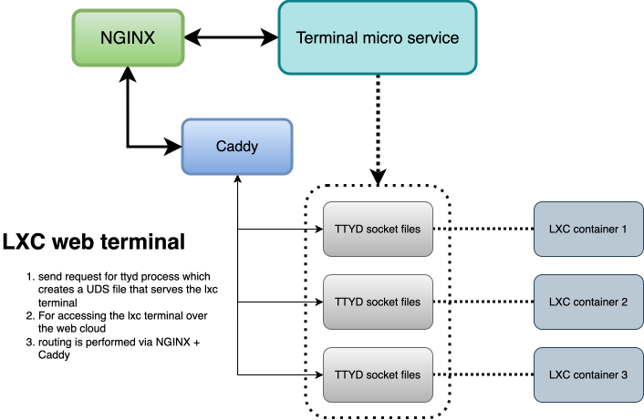

# LXC web terminal 

This project aims to provide web based access to the bash based terminals of LXC containers 

## Supported Features

- launch a new terminal interface for a specified container
- close the terminal session based upon REST API request
- Auto session timeout parameter which can be configured (default 30mins)
- Unix domain socket based routing which makes spawning session easy
- Caddy reverse proxy for providing http URI to UDS based routing 
- JWT token authentication in the header using caddy-jwt plugin

## dependencies

- Caddy reverse proxy with custom plugin built of caddy-jwt to support token based authentication 
- TTYD for providing web interface of the given bash terminal ( for our case this is LXC)
- A good SSD with nice throughput support for reading/writing related operations
- proper folders permissions for creating UDS files on that path 

## Architecture

<p align="center">
    
</p>

Figure: High-level architecture — Caddy (with caddy-jwt) routes HTTP to Unix domain sockets, forwarding to the terminal service (ttyd) that attaches to LXC containers; JWT in the request header provides authentication.

## Installation

```bash
# Clone the repository
git clone https://github.com/yourusername/mizzle-infra-terminal.git
cd mizzle-infra-terminal

# run program under the service file or someother 
cargo r -r

# setup caddy binary for the config, you may run this as a service file 
caddy run --config ./path/to/CaddyFile --caddyFile

```


## Contributing

Contributions are welcome! Please open issues or submit pull requests.

## License

This project is licensed under the MIT License.